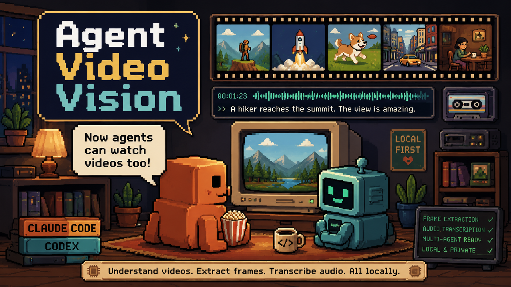

<p align="center">
  
</p>

# agent-video-vision

Give your coding agent the ability to **watch and understand videos** — fully local, no API keys, ever.

A local-only video perception MCP server that works with **Claude Code** and **OpenAI Codex CLI** — as a native plugin on both. It extracts frames via ffmpeg and transcribes audio on your CPU. Your agent receives frames (or frame file paths) and transcription with timestamps — this is a **perception layer**, not an interpretation layer. One shared core; thin per-host packaging.


## What it is

- **Dual plugin** — one repo, two manifests: `.claude-plugin/plugin.json` (Claude Code) and `.codex-plugin/plugin.json` (Codex CLI). Skills, MCP config, and assets are shared at the repo root.
- **Agent-agnostic** — same MCP server and skills for Claude Code and Codex CLI
- **Local-only transcription** — Fluid Speech Mini (ONNX, CPU, ~300MB) or Whisper. The Gemini/OpenAI API backends from upstream are removed. No API keys anywhere.
- **Multimodal perception** — the agent sees frames directly and reads timestamped transcription
- **YouTube support** — pass a URL; the server downloads it with `yt-dlp` and prefers YouTube captions
- **Adaptive extraction** — the agent adjusts fps, time range, and resolution based on your question

## Why

- **Privacy.** Video, audio, and transcription never leave your machine. The only network calls are model downloads at setup time and optional YouTube downloads.
- **Zero API cost.** Transcription runs on your CPU. No metered speech APIs.
- **Subscription-safe billing.** The server makes **zero LLM calls**. All visual understanding happens inside the calling agent's interactive session — so it uses your existing Claude or ChatGPT subscription. It never needs API keys, never touches the post-June-15 Agent SDK credit, and never runs headless `claude -p`.

## Supported hosts

| Host | Packaging | Frame delivery | Frame descriptions mode |
|---|---|---|---|
| **Claude Code** | Plugin (`.claude-plugin/` — skills + commands + agents + MCP server) | Inline images (`frame_mode: "images"`) | Spawns the `frame-describer` subagent |
| **OpenAI Codex CLI** | Plugin (`.codex-plugin/` — skills + MCP server; see [codex/README.md](./codex/README.md)) | Frame file paths (`frame_mode: "paths"` — Codex can't see inline MCP images) | Codex views frame files via `view_image`, or delegates batches to the `frame-describer` custom agent |

## Quick start

### Claude Code

```
/plugin marketplace add https://github.com/bengemine/agent-video-vision
/plugin install agent-video-vision
```

Or for local development:

```bash
git clone https://github.com/bengemine/agent-video-vision ~/agent-video-vision
cd ~/agent-video-vision/mcp-server && npm install && npm run build
claude --plugin-dir ~/agent-video-vision
```

Then say "set up video vision" (or run `/setup-video-vision` — a thin wrapper around the same setup skill).

Use it:

```
/watch-video path/to/video.mp4 "what happens in this video?"
```

Or just mention a video file in conversation — the skill triggers automatically.

### Codex CLI

Install the **agent-video-vision** plugin from the Codex plugin browser / marketplace, or grab the skills directly:

```bash
npx skills add bengemine/agent-video-vision
```

Then ask Codex to "set up video vision" — the setup skill wires the MCP server, installs the `frame-describer` custom agent, and switches to `frame_mode: "paths"`. Details and manual fallback in [codex/README.md](./codex/README.md).

### Using both agents?

Don't install the plugin twice — you'd get two separate clones that drift apart. Instead keep **one clone at `~/agent-video-vision`**, build it once, and wire it into each host manually: `claude mcp add agent-video-vision -s user -- node ~/agent-video-vision/mcp-server/dist/index.js` for Claude Code, the `config.toml` block from [codex/README.md](./codex/README.md) for Codex. Skills work from one shared location (`~/.agents/skills/`) for both. The heavy parts (model, venv, config in `~/.agent-video-vision/`) are always shared either way.

## Transcription engines

| | **fluid-speech** (recommended) | **whisper-cpp** | **whisper-python** |
|---|---|---|---|
| Model | [Fluid Speech Mini](https://fluidvoice.com/labs/fluid-speech-mini) (ONNX, 2/4-bit) | whisper.cpp (`whisper-cli`) | openai-whisper (Python) |
| Download | ~300MB | 75MB–3GB per model | 75MB–3GB per model |
| Speed on CPU | ~8x realtime, ~0.7GB RAM | ~1–2x realtime | ~1x realtime |
| Accuracy | Parakeet-class (4.5% WER on the Open ASR English sets, vendor-reported); robust to other voices in the room | Good | Good |
| Languages | English only | 99 languages | 99 languages |
| Runs via | Python 3.12+ venv + [ONNX Runtime](https://onnxruntime.ai) ≥ 1.31 | `whisper-cli` binary | `whisper` CLI |

Pick **fluid-speech** for English. For any other language use **whisper-cpp**.

Fluid Speech Mini is a distilled model built on NVIDIA Parakeet TDT 0.6B v3 and Moondream Parakeet Ultra (CC BY 4.0). Segment timestamps come straight from its token-and-duration decoder, so no separate voice-activity model is needed.

## Setup flow

Models are **never shipped in the repo**. Setup downloads them:

**Fluid Speech Mini** (one-time, ~300MB):

```bash
# 1. Create a Python 3.12+ venv for ONNX Runtime (uv downloads 3.12 if needed)
uv venv --python 3.12 ~/.agent-video-vision/venv
# (or, with a system Python 3.12+: python3.12 -m venv ~/.agent-video-vision/venv)

# 2. Install ONNX Runtime 1.31+ and the small helpers
uv pip install --python ~/.agent-video-vision/venv/bin/python "onnxruntime>=1.31" numpy soundfile huggingface_hub

# 3. Download the ONNX build from HuggingFace
~/.agent-video-vision/venv/bin/python -c "from huggingface_hub import snapshot_download; snapshot_download('FluidVoice-Labs/fluid-speech-mini-onnx', local_dir='$HOME/.agent-video-vision/models/fluid-speech-mini-onnx', ignore_patterns=['assets/*'])"
```

The `setup-video-vision` skill (both hosts; `/setup-video-vision` on Claude Code is a thin wrapper around it) walks you through this with exact commands, verifies each step via the `video_setup` tool, and finishes with host-specific steps (on Codex: MCP wiring, `frame-describer` agent install, paths mode).

**Already have the model on disk?** Point the config at it instead of downloading:

```
video_configure { "fluid_model_dir": "/path/to/fluid-speech-mini-onnx" }
```

**Whisper** models auto-download from HuggingFace (`ggerganov/whisper.cpp`) on first use, as upstream did.

## Configuration

Settings live in `~/.agent-video-vision/config.json`:

```json
{
  "engine": "fluid-speech",
  "whisper_model": "auto",
  "fluid_model_dir": "~/.agent-video-vision/models/fluid-speech-mini-onnx",
  "fluid_python": "~/.agent-video-vision/venv/bin/python",
  "frame_resolution": 512,
  "default_fps": "auto",
  "max_frames": 100,
  "frame_format": "jpeg",
  "frame_mode": "images"
}
```

(`~` shown for brevity — the server does not expand `~`; the defaults and `video_configure` store absolute paths.)

| Key | Values | Notes |
|---|---|---|
| `engine` | `fluid-speech` \| `whisper-cpp` \| `whisper-python` | Transcription engine |
| `whisper_model` | `tiny`…`large-v3`, `auto` | Whisper engines only; auto-downloads |
| `fluid_model_dir` | path | Fluid Speech Mini ONNX model directory |
| `fluid_python` | path | Python 3.12+ interpreter in the venv |
| `frame_resolution` | px width (256–1024+) | Height auto-scales |
| `default_fps` | `auto` or number | Extraction rate |
| `max_frames` | number | Hard cap per extraction |
| `frame_format` | `jpeg` \| `png` \| `webp` | `png` for sharp text/UI |
| `frame_mode` | `images` \| `paths` \| `descriptions` | See "Frame delivery modes" below |

(`frame_describer_model` from upstream is removed — descriptions are now host-fulfilled.)

## MCP tools

| Tool | Purpose |
|---|---|
| `video_info` | Get metadata (duration, resolution, audio presence) without processing |
| `video_analyze` | Run ffmpeg analytical filters (scene changes, silence, motion, blur, exposure, loudness) + optional transcription. Use **before** extracting frames to plan where to look. |
| `video_watch` | Extract frames + transcribe audio (main tool). Supports `segments` with per-range fps/resolution, `view_sample`, `skip_audio`. |
| `video_detail` | Drill into specific moments — extract many frames, view few. `view_sample` for evenly spaced frames, `view` for exact timestamps. |
| `video_setup` | Check dependencies (ffmpeg, engine, venv, model) and report what's missing with install guidance |
| `video_configure` | Read/change settings in `config.json` |

### Frame delivery modes

`frame_mode` controls how `video_watch` / `video_detail` deliver frames:

- **`images`** (Claude Code default) — frames return as inline images in the MCP tool result.
- **`paths`** (Codex default) — the tools return `timestamp -> /abs/path` lists of extracted frame files. Use this on Codex: inline MCP images are invisible to it, so it opens the files with its `view_image` tool.
- **`descriptions`** — host-fulfilled text descriptions (fewest tokens), see below.

### Frame descriptions (host-fulfilled)

With `frame_mode: "descriptions"`, the server returns frames plus a neutral instruction — it never calls an LLM itself:

- **Claude Code** spawns the bundled `frame-describer` subagent to turn frames into text.
- **Codex** opens frame files (paths mode) and describes them itself, or delegates batches to the `frame-describer` custom agent — installed to `~/.codex/agents/` by the setup skill and invoked by name.

## Requirements

- **Node.js 20+** — MCP server
- **ffmpeg** — frame/audio extraction (`apt install ffmpeg` / `brew install ffmpeg`)
- **Python 3.12+** — fluid-speech engine only (for the venv; `uv` can install it for you)
- **whisper-cli** — whisper-cpp engine only (`brew install whisper-cpp` or build from source)
- **yt-dlp** — optional, YouTube URLs only

## Troubleshooting

- **No Python 3.12 on the system** — use [uv](https://github.com/astral-sh/uv): `uv venv --python 3.12 ~/.agent-video-vision/venv` downloads a private 3.12 for the venv. `python3 -m venv` on 3.10/3.11 will not work: ONNX Runtime 1.31 (needed for the model's 2-bit weights) only ships for 3.12+.
- **"Only 4b and 8b quantization is supported for MatMulNBits"** — the venv has an ONNX Runtime older than 1.31. Recreate it on Python 3.12+ as above.
- **Model loads slowly in WSL** — model dirs under `/mnt/*` (Windows drives) read much slower than the Linux filesystem. Copy the model into `~/.agent-video-vision/models/` for fast loads.
- **`video_watch` fails with a setup error** — run `video_setup` (or `/setup-video-vision` in Claude Code) to see exactly which dependency is missing.

## Credits

- **Fluid Speech Mini by FluidVoice** — model and reference ONNX runner ([FluidVoice-Labs/fluid-speech-mini-onnx](https://huggingface.co/FluidVoice-Labs/fluid-speech-mini-onnx), CC BY 4.0). `python/fluid_speech_transcribe.py` adapts that runner and adds timestamped segments.
- Built on NVIDIA Parakeet TDT 0.6B v3 and Moondream Parakeet Ultra (CC BY 4.0).

## License

MIT — see [LICENSE](./LICENSE).
